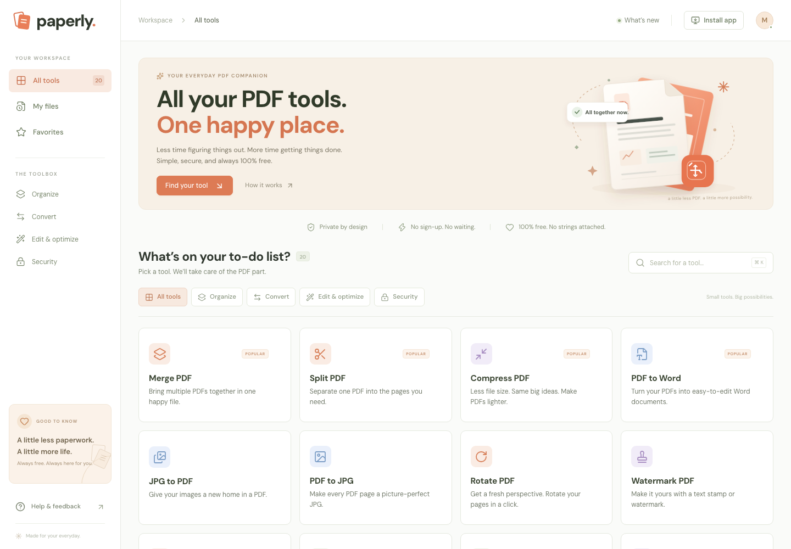
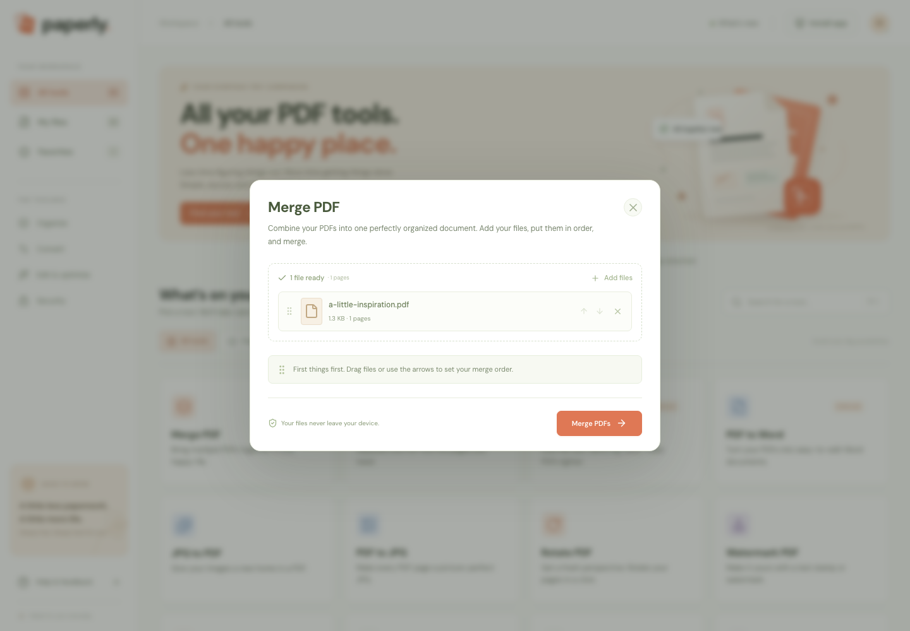
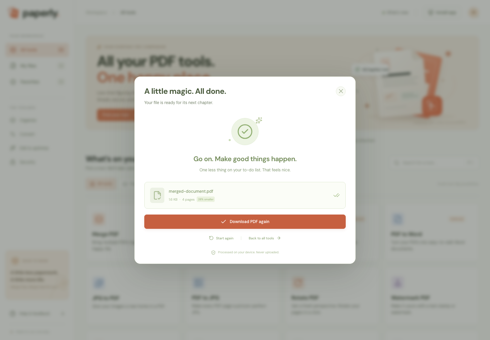
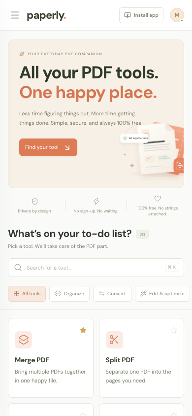

<div align="center">


# paperly

**All your PDF tools. One happy place.**

A free, private, installable PDF workspace. **Every file is processed on your own device** — nothing is uploaded, stored, or sent to a server.

[](https://nextjs.org)
[](https://react.dev)
[](https://www.typescriptlang.org)
[](https://tailwindcss.com)
[](https://orm.drizzle.team)
[](LICENSE)



</div>

## What it is

paperly is a browser-based PDF toolkit with **20 tools** that run entirely client-side. Merge, split, compress, convert, sign off on security — all without an account, a subscription, or your files ever leaving the browser tab.

- **Private by design.** PDF processing uses `pdf-lib` and `pdf.js` compiled into the page. No upload endpoint exists.
- **No sign-up, no paywall.** Open it and use it.
- **Installable PWA.** Works offline for the app shell and for merging PDFs already cached.
- **Postgres is optional.** The database only stores favorites, a workspace name, metadata-only history and feedback. Remove it and every PDF tool still works — the UI falls back to local storage.

## The toolbox

| Organize | Convert | Edit & optimize | Security |
| --- | --- | --- | --- |
| Merge PDF | PDF to Word | Compress PDF | Protect PDF |
| Split PDF | Word to PDF | Watermark PDF | Unlock PDF |
| Rotate PDF | JPG to PDF | Page numbers | |
| Organize PDF | PDF to JPG | Crop PDF | |
| Remove pages | PDF to PNG | Repair PDF | |
| Extract pages | PDF to text | Flatten PDF | |

Extras: searchable categories, persistent favorites, guest workspace settings, private metadata-only history, built-in sample documents, drag-and-drop file ordering, and downloadable results.

<div align="center">


</div>

## Tech stack

| Layer | Choice |
| --- | --- |
| Framework | Next.js 16 (App Router, Turbopack) |
| UI | React 19, Tailwind CSS v4, lucide-react |
| PDF engine | pdf-lib, pdfjs-dist (worker, fonts, CMaps and WASM self-hosted) |
| Conversion | docx, mammoth, jszip, sharp |
| Data | PostgreSQL + Drizzle ORM (`pg`) |
| Testing | Playwright (end-to-end browser suite) |

## Run locally

```bash
npm install
cp .env.example .env      # optional: set DATABASE_URL for history/favorites
npx drizzle-kit push      # only needed if you set DATABASE_URL
npm run dev
```

Open <http://localhost:3000>. The database is optional: without `DATABASE_URL` the app builds and runs, and every PDF tool works.

## Deploy to Vercel

1. Push this repository to GitHub and import it in Vercel.
2. In the Vercel dashboard, add a **Postgres database from the Marketplace (Neon)** to the project. Vercel injects `DATABASE_URL` automatically.
3. Apply the schema to the production database once:
   ```bash
   DATABASE_URL="<neon-url>" npx drizzle-kit push
   ```
4. Deploy. No other environment variables or build settings are required.

Without a database the deploy still succeeds and every PDF tool works; only favorites/history/feedback are disabled (they fall back to browser local storage).

The concrete production setup (Vercel team, Supabase project, secrets) is recorded in [`docs/DEPLOYMENT.md`](docs/DEPLOYMENT.md).

## Project structure

```
src/
  app/            # App Router pages, layout, manifest, API routes
    api/health/   # DB health probe
    api/workspace/# favorites, history, workspace name, feedback
  components/     # UI: app shell, tool dialog, modals, hero art
  db/             # Drizzle client (lazy) and schema
  lib/
    pdf-engine.ts # all 20 tool implementations
    tools.ts      # tool registry and metadata
public/
  pdf-assets/     # self-hosted pdf.js worker, CMaps, fonts, WASM
  sw.js           # service worker (offline app shell)
tests/            # Playwright smoke and edge-case suites
```

## Verification

```bash
npx next typegen                              # route types
npm exec tsc -- --noEmit --pretty false       # type check
npm run build                                 # production build
npm run lint                                  # eslint
```

End-to-end checks against a running production app:

```bash
npx playwright install --with-deps chromium
npm run build && npm start &
TEST_URL=http://127.0.0.1:3000 node tests/smoke.mjs
TEST_URL=http://127.0.0.1:3000 node tests/edge-cases.mjs
```

The suite exercises all 20 tools, validates the actual downloaded files, and covers search, favorites, database-backed history, workspace isolation, PWA caching, offline PDF merging, keyboard navigation and mobile layout. Screenshots and outputs land in `.artifacts/`.

## Privacy and persistence

The server stores a private guest workspace ID in a first-party HTTP-only cookie, favorites, a workspace name, and recent job metadata (tool, file name, sizes, page count, timestamp). **No document content is stored in PostgreSQL.** Feedback is saved only when explicitly submitted.

History is also mirrored to local storage for offline resilience and synchronized on reconnect. Local file contents are never written to the service worker cache. Clear history from Workspace settings. Guest workspaces are tied to the browser cookie; there are no cross-device accounts or public file sharing.

## PWA

The app ships a web manifest, install icons and a service worker. The app shell, self-hosted fonts and already-used tool assets are available offline; tool-specific pdf.js modules are cached on first use. Install from the browser menu (service workers require HTTPS or localhost). The pdf.js worker, fonts, CMaps and WASM live in `public/pdf-assets/`.

<div align="center">

</div>

## Honest limitations

- **Safety limits:** 20 files, 50 MB per file, 150 MB per task, 500 PDF pages.
- **PDF to Word** produces editable text-based DOCX; complex layouts may need reformatting. Scanned pages need OCR, which is not included.
- **Word to PDF** preserves basic headings, paragraphs, lists and supported images. Advanced Word layouts are simplified.
- **Compress, Flatten and Unlock** render pages as images, so selectable text, annotations, form behavior and links are not retained in those outputs. The original is kept if compression would enlarge the file.
- **Repair** rebuilds recoverable PDF structure; it cannot recover missing data.
- **Protect** uses 128-bit RC4 compatibility encryption, not modern AES. Passwords are never stored. Unlocking requires the correct existing password; advanced encryption may need a desktop PDF reader. Only process documents you have permission to edit.
- Keep originals and review generated documents. Local processing depends on the browser and available memory.

The public application requires no login, paid subscription, external PDF API or secret keys for PDF processing. The PDF engine and fonts are self-hosted.